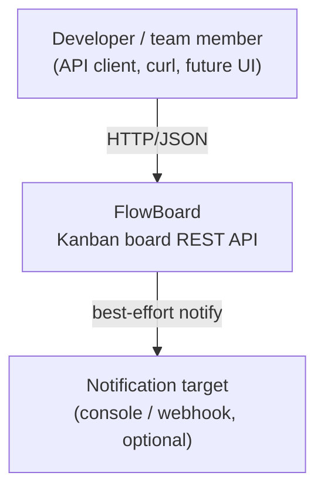
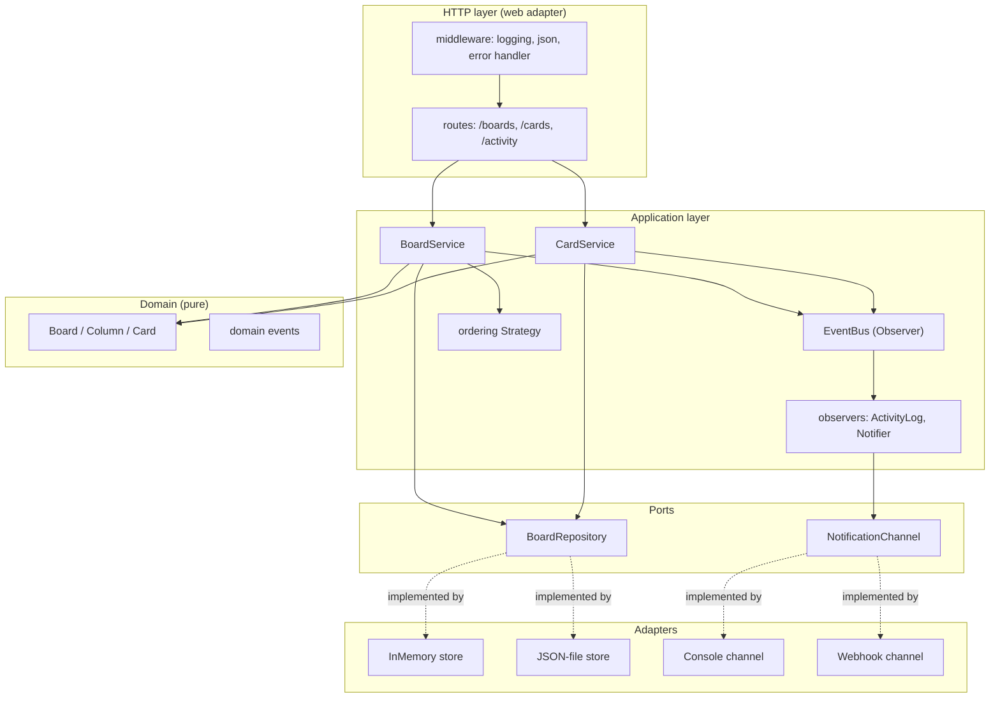

# FlowBoard — Architecture

This document explains the structure: the styles, the layers, the C4 views, and how a
request flows through the system. The decision records are in [`adr/`](adr/); the quality
goals are in [`quality-attributes.md`](quality-attributes.md).

---

## 1. C4 — Context

Who uses it and what it talks to.

## 2. C4 — Containers / Components

FlowBoard is a single deployable (one Node process, one container). Inside it, the
components are arranged in layers with dependencies pointing inward.

The dashed "implemented by" arrows are the only place concretes attach, and `src/config.js`
(the composition root) is the only file that chooses which.

---

## 3. The three styles, and why each is here

**Layered / hexagonal (ports & adapters).** The primary style. Four rings — HTTP → application
→ domain, with adapters plugging into ports at the edge. Dependencies point inward, so the
domain and the business rules never import Express or a database driver. *Benefit:* you can
replace the web framework or the storage without touching the rules. *Cost:* more files and
a bit of indirection than a flat script — worth it the moment the app outlives a prototype.

**Event-driven.** The write path (services) publishes domain events to an in-process bus;
observers (activity log, notifier) subscribe. The services don't know the observers exist.
*Benefit:* side-effects (logging what happened, telling someone) are added or removed without
editing a single service — the activity feed and notifications were literally bolted on by
subscribing. *Cost:* the flow is less linear to trace; mitigated by keeping the bus tiny and
in-process.

**Plugin / microkernel.** Storage and notifications are plugins behind ports. *Benefit:*
`PERSISTENCE=file` vs `memory`, or adding a Slack channel, is configuration, not a code
change. *Cost:* every plugin point is an interface to maintain — so we only made the two
things that genuinely vary (storage, channels) pluggable, not everything.

---

## 4. How a request flows

`POST /boards/:id/columns/:col/cards  {title, priority}`

1. **Middleware** — request logged, JSON body parsed.
2. **Route** (`http/routes/cards.js`) — pulls params/body, calls `cardService.createCard`.
   No business logic here.
3. **CardService** — loads the `Board` via the repository *port*, asks the domain to create
   and place the `Card` (which enforces its own invariants), saves through the port, and
   **publishes** a `card.created` event.
4. **Observers** — the `ActivityLog` records it; the `Notifier` turns it into a message and
   sends it to every channel. The service already returned — these are reactions.
5. **Route** — serialises the card to JSON, `201`.
6. If anything threw, the **error handler** maps the error type to a status (`DomainError`
   → 400, `NotFoundError` → 404) — the one place HTTP codes are decided.

---

## 5. Why a monolith (the headline decision)

See [ADR-0001](adr/0001-modular-monolith.md) in full. Short version: for a system this size,
microservices would add network hops, partial-failure handling, and per-service deployment
for no benefit. FlowBoard keeps **strong internal module boundaries** (the layers and ports)
so that *if* one part ever needed to scale independently, the seam to cut along already
exists. That's the modular monolith: monolith simplicity now, a clean split available later.
